# 前端基线报告（迁移前）

> 由 `scripts/ui-baseline.mjs` 生成，配合 `docs/PLAN-frontend-webcomponents.md` 阶段 0 使用。
> 重新运行脚本会覆盖本文件的机器部分，但会保留 `VISUAL-REVIEW.md` 中的人工视觉复核内容。

- 生成时间：2026-10-15T08:02:08.835Z
- 二进制：`D:\Desktop\nunt\nunt.exe`（30037504 字节）
- 数据目录：`D:\Desktop\nunt\.gocache\ui-baseline\1792051302297`（运行结束后已删除）
- 浏览器：Mozilla/5.0 (Windows NT 10.0; Win64; x64) AppleWebKit/537.36 (KHTML, like Gecko) HeadlessChrome/156.0.8078.4 Safari/537.36
- 视口：1440x900，color-scheme dark，语言 zh-CN
- axe-core：4.14.0（本地注入，运行时版本 4.14.0；规则标签 wcag2a, wcag2aa, wcag21a, wcag21aa, best-practice）
- 运行环境：v24.15.0 / playwright 1.64.1

## 1. 结论速览

| 指标 | 数值 |
| --- | --- |
| 页面数 | 12 |
| 页面未挂载出内容 | 0 |
| 达到网络空闲的页面 | 12/12 |
| console 报错+警告 | 2 |
| 未捕获异常（pageerror） | 0 |
| 失败请求 | 0 |
| HTTP 4xx/5xx 响应 | 2 |
| axe 严重 critical | 26 |
| axe 重要 serious | 110 |
| axe 中等 moderate | 188 |
| axe 轻微 minor | 7 |
| 横向溢出的页面 | 0 |
| 文档高度平均值 | 1093px |

演示数据播种：11/11 成功。

## 2. 演示数据（由管理 API 播种）

| 步骤 | 请求 | 状态 | 结果 |
| --- | --- | --- | --- |
| 存储挂载（本地目录） | `POST /api/v1/storage/mounts` | 200 | OK（id=e7eb52686bb68401） |
| Web 规则：静态托管 | `POST /api/v1/web/rules` | 200 | OK（id=a092163b0fed80f3） |
| Web 规则：反向代理 | `POST /api/v1/web/rules` | 200 | OK（id=7cfb53051449ff73） |
| 端口转发规则 | `POST /api/v1/forward/rules` | 201 | OK（id=439458bdb5f1440f） |
| DDNS 规则 | `POST /api/v1/ddns/rules` | 200 | OK（id=586c0cc5df761ab9） |
| WAF 配置 | `PUT /api/v1/waf/config` | 200 | OK |
| 通知 Webhook | `PUT /api/v1/notify/webhooks` | 200 | OK |
| 计划任务 | `POST /api/v1/task/items` | 201 | OK（id=ba41d92ea56b936a） |
| 证书任务（未启用） | `POST /api/v1/acme/jobs` | 200 | OK（id=0eeb076b6afe3d96） |
| API Token | `POST /api/v1/auth/tokens` | 200 | OK（id=71034442657d632a） |
| 第二个管理员账号 | `POST /api/v1/auth/users` | 200 | OK（id=cac8849f9abfedc4） |

## 3. 逐页结果

### 登录页（附加）

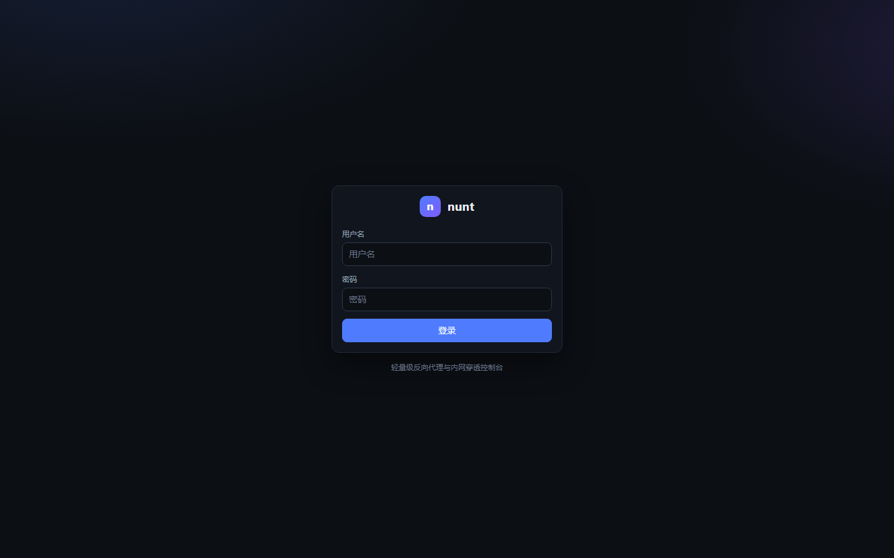

- 截图：[login.png](login.png)
- console 报错与警告：

```text
[error] Failed to load resource: the server responded with a status of 401 (Unauthorized)
```
- 失败请求：（无）
- axe：严重 1 / 重要 28 / 中等 22 / 轻微 0（通过项 24）

### 概览（`#/dashboard`）

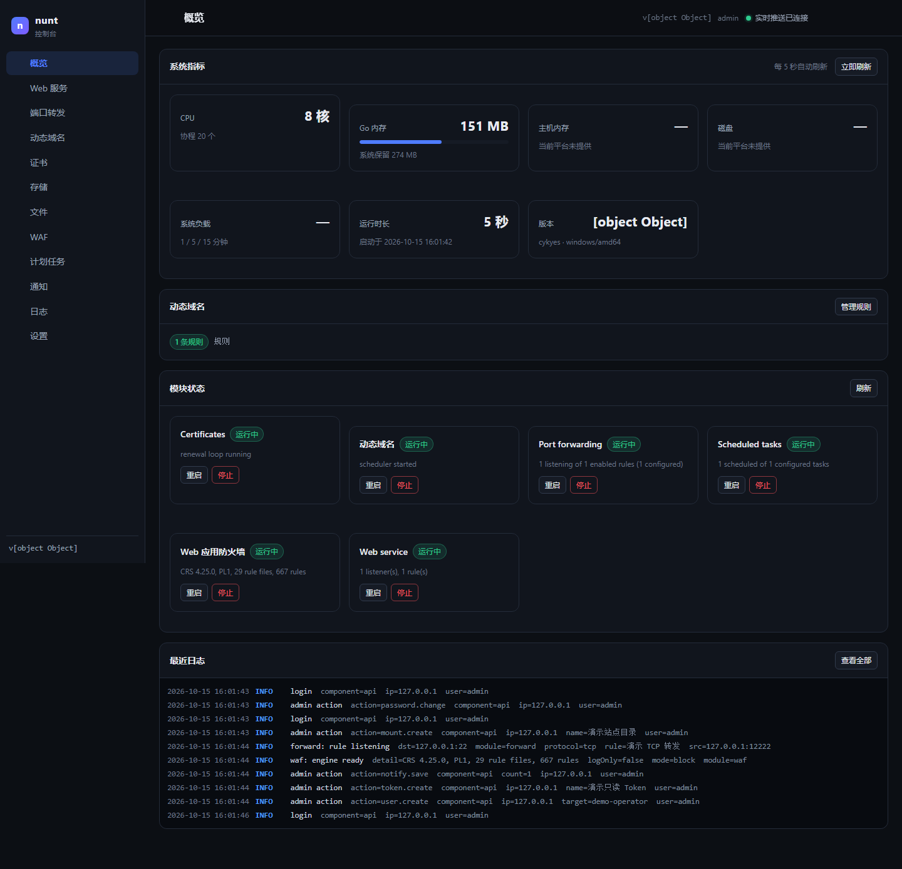

- 截图：[dashboard.png](dashboard.png) ｜ URL `http://127.0.0.1:16601/#/dashboard`
- 挂载：是 ｜ 网络空闲：是 ｜ 采集耗时 1734ms
- 顶栏标题 `概览` ｜ 内容子节点 1 ｜ 文档高度 1389px ｜ 视口宽 1440
- axe：严重 1 / 重要 28 / 中等 22 / 轻微 0（通过项 24，待人工确认 1）

**console 报错与警告**

```text
（无）
```

**未捕获异常**

```text
（无）
```

**失败请求**

```text
（无）
```

**HTTP 4xx/5xx**

```text
（无）
```

**axe 违规明细**

| 规则 | 影响 | 节点数 | 说明 | 示例选择器 |
| --- | --- | --- | --- | --- |
| `button-name` | critical | 1 | Buttons must have discernible text | `button[data-theme-toggle="1"]` |
| `color-contrast` | serious | 28 | Elements must meet minimum color contrast ratio thresholds | `.brand-sub`, `.active > .nav-text`, `.meta:nth-child(4) > .mono[data-version="1"][title="版本信息"]` |
| `landmark-one-main` | moderate | 1 | Document should have one main landmark | `html` |
| `page-has-heading-one` | moderate | 1 | Page should contain a level-one heading | `html` |
| `region` | moderate | 20 | All page content should be contained by landmarks | `.card:nth-child(1) > .card-header > span:nth-child(1)`, `.sub`, `.page > .card:nth-child(1) > .card-body` |

### Web 服务（`#/web`）

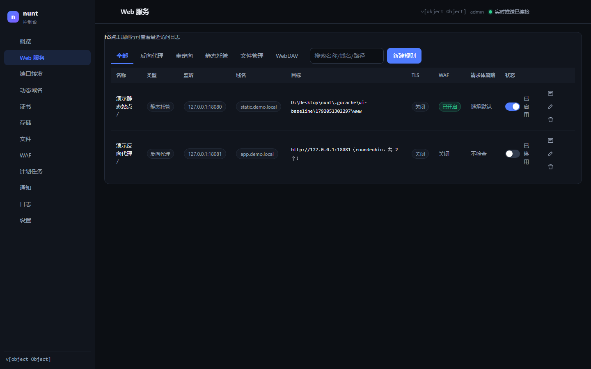

- 截图：[web.png](web.png) ｜ URL `http://127.0.0.1:16601/#/web`
- 挂载：是 ｜ 网络空闲：是 ｜ 采集耗时 1633ms
- 顶栏标题 `Web 服务` ｜ 内容子节点 1 ｜ 文档高度 900px ｜ 视口宽 1440
- axe：严重 1 / 重要 5 / 中等 23 / 轻微 1（通过项 31，待人工确认 1）

**console 报错与警告**

```text
（无）
```

**未捕获异常**

```text
（无）
```

**失败请求**

```text
（无）
```

**HTTP 4xx/5xx**

```text
（无）
```

**axe 违规明细**

| 规则 | 影响 | 节点数 | 说明 | 示例选择器 |
| --- | --- | --- | --- | --- |
| `button-name` | critical | 1 | Buttons must have discernible text | `button[data-theme-toggle="1"]` |
| `color-contrast` | serious | 5 | Elements must meet minimum color contrast ratio thresholds | `.brand-sub`, `button[data-page="web"] > .nav-text`, `.meta:nth-child(4) > .mono[data-version="1"][title="版本信息"]` |
| `empty-table-header` | minor | 1 | Table header text should not be empty | `th:nth-child(10)` |
| `landmark-one-main` | moderate | 1 | Document should have one main landmark | `html` |
| `page-has-heading-one` | moderate | 1 | Page should contain a level-one heading | `html` |
| `region` | moderate | 21 | All page content should be contained by landmarks | `.card-head`, `.input`, `thead` |

### 端口转发（`#/forward`）

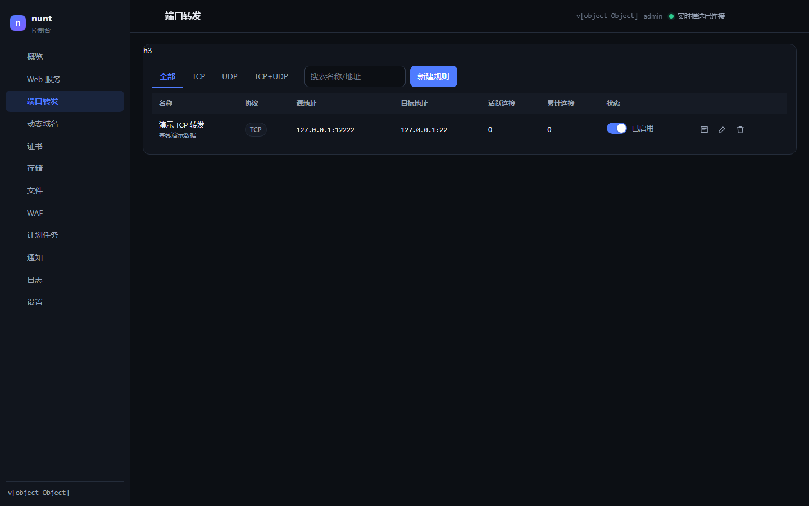

- 截图：[forward.png](forward.png) ｜ URL `http://127.0.0.1:16601/#/forward`
- 挂载：是 ｜ 网络空闲：是 ｜ 采集耗时 1629ms
- 顶栏标题 `端口转发` ｜ 内容子节点 1 ｜ 文档高度 900px ｜ 视口宽 1440
- axe：严重 1 / 重要 5 / 中等 12 / 轻微 1（通过项 31，待人工确认 1）

**console 报错与警告**

```text
（无）
```

**未捕获异常**

```text
（无）
```

**失败请求**

```text
（无）
```

**HTTP 4xx/5xx**

```text
（无）
```

**axe 违规明细**

| 规则 | 影响 | 节点数 | 说明 | 示例选择器 |
| --- | --- | --- | --- | --- |
| `button-name` | critical | 1 | Buttons must have discernible text | `button[data-theme-toggle="1"]` |
| `color-contrast` | serious | 5 | Elements must meet minimum color contrast ratio thresholds | `.brand-sub`, `button[data-page="forward"] > .nav-text`, `.meta:nth-child(4) > .mono[data-version="1"][title="版本信息"]` |
| `empty-table-header` | minor | 1 | Table header text should not be empty | `th:nth-child(8)` |
| `landmark-one-main` | moderate | 1 | Document should have one main landmark | `html` |
| `page-has-heading-one` | moderate | 1 | Page should contain a level-one heading | `html` |
| `region` | moderate | 10 | All page content should be contained by landmarks | `.card-head`, `.input`, `thead` |

### 动态域名（`#/ddns`）

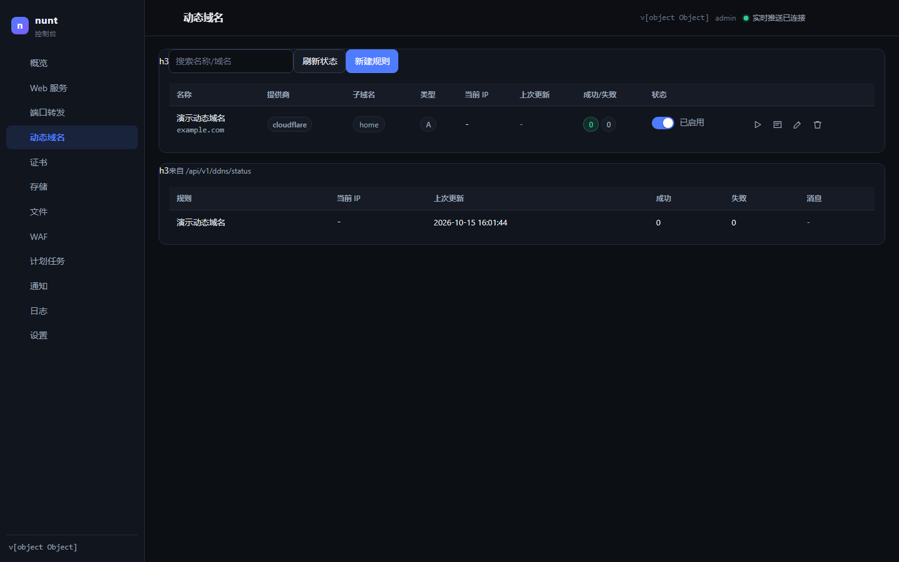

- 截图：[ddns.png](ddns.png) ｜ URL `http://127.0.0.1:16601/#/ddns`
- 挂载：是 ｜ 网络空闲：是 ｜ 采集耗时 1661ms
- 顶栏标题 `动态域名` ｜ 内容子节点 1 ｜ 文档高度 900px ｜ 视口宽 1440
- axe：严重 1 / 重要 5 / 中等 14 / 轻微 1（通过项 31，待人工确认 1）

**console 报错与警告**

```text
（无）
```

**未捕获异常**

```text
（无）
```

**失败请求**

```text
（无）
```

**HTTP 4xx/5xx**

```text
（无）
```

**axe 违规明细**

| 规则 | 影响 | 节点数 | 说明 | 示例选择器 |
| --- | --- | --- | --- | --- |
| `button-name` | critical | 1 | Buttons must have discernible text | `button[data-theme-toggle="1"]` |
| `color-contrast` | serious | 5 | Elements must meet minimum color contrast ratio thresholds | `.brand-sub`, `.active > .nav-text`, `.meta:nth-child(4) > .mono[data-version="1"][title="版本信息"]` |
| `empty-table-header` | minor | 1 | Table header text should not be empty | `th:nth-child(9)` |
| `landmark-one-main` | moderate | 1 | Document should have one main landmark | `html` |
| `page-has-heading-one` | moderate | 1 | Page should contain a level-one heading | `html` |
| `region` | moderate | 12 | All page content should be contained by landmarks | `.card:nth-child(2) > .card-head > span:nth-child(1)`, `.input`, `.card-body > div > table > thead` |

### 证书（`#/acme`）

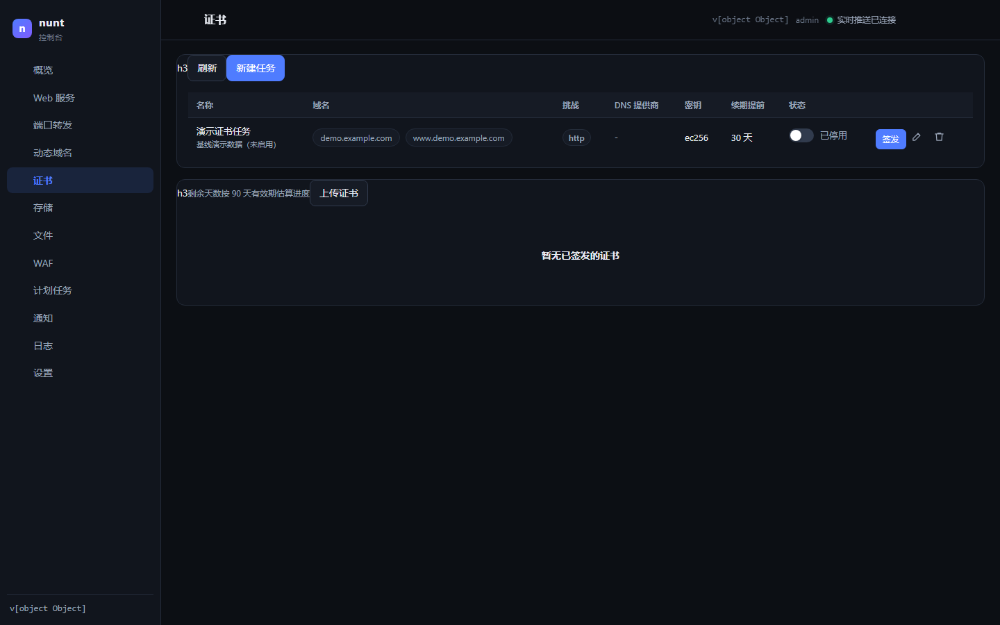

- 截图：[acme.png](acme.png) ｜ URL `http://127.0.0.1:16601/#/acme`
- 挂载：是 ｜ 网络空闲：是 ｜ 采集耗时 1690ms
- 顶栏标题 `证书` ｜ 内容子节点 1 ｜ 文档高度 900px ｜ 视口宽 1440
- axe：严重 1 / 重要 6 / 中等 14 / 轻微 1（通过项 31，待人工确认 1）

**console 报错与警告**

```text
（无）
```

**未捕获异常**

```text
（无）
```

**失败请求**

```text
（无）
```

**HTTP 4xx/5xx**

```text
（无）
```

**axe 违规明细**

| 规则 | 影响 | 节点数 | 说明 | 示例选择器 |
| --- | --- | --- | --- | --- |
| `button-name` | critical | 1 | Buttons must have discernible text | `button[data-theme-toggle="1"]` |
| `color-contrast` | serious | 6 | Elements must meet minimum color contrast ratio thresholds | `.brand-sub`, `.active > .nav-text`, `.meta:nth-child(4) > .mono[data-version="1"][title="版本信息"]` |
| `empty-table-header` | minor | 1 | Table header text should not be empty | `th:nth-child(8)` |
| `landmark-one-main` | moderate | 1 | Document should have one main landmark | `html` |
| `page-has-heading-one` | moderate | 1 | Page should contain a level-one heading | `html` |
| `region` | moderate | 12 | All page content should be contained by landmarks | `.card:nth-child(2) > .card-head > span:nth-child(1)`, `thead`, `td:nth-child(1)` |

### 存储（`#/storage`）

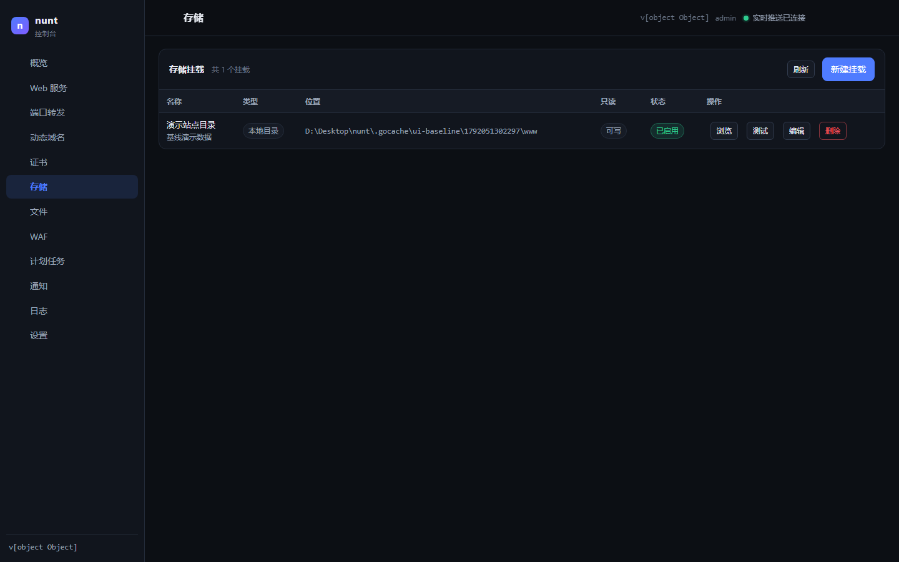

- 截图：[storage.png](storage.png) ｜ URL `http://127.0.0.1:16601/#/storage`
- 挂载：是 ｜ 网络空闲：是 ｜ 采集耗时 1627ms
- 顶栏标题 `存储` ｜ 内容子节点 1 ｜ 文档高度 900px ｜ 视口宽 1440
- axe：严重 1 / 重要 6 / 中等 10 / 轻微 0（通过项 28，待人工确认 1）

**console 报错与警告**

```text
（无）
```

**未捕获异常**

```text
（无）
```

**失败请求**

```text
（无）
```

**HTTP 4xx/5xx**

```text
（无）
```

**axe 违规明细**

| 规则 | 影响 | 节点数 | 说明 | 示例选择器 |
| --- | --- | --- | --- | --- |
| `button-name` | critical | 1 | Buttons must have discernible text | `button[data-theme-toggle="1"]` |
| `color-contrast` | serious | 6 | Elements must meet minimum color contrast ratio thresholds | `.brand-sub`, `.active > .nav-text`, `.meta:nth-child(4) > .mono[data-version="1"][title="版本信息"]` |
| `landmark-one-main` | moderate | 1 | Document should have one main landmark | `html` |
| `page-has-heading-one` | moderate | 1 | Page should contain a level-one heading | `html` |
| `region` | moderate | 8 | All page content should be contained by landmarks | `.card-header > span:nth-child(1)`, `.sub`, `thead` |

### 文件（`#/files`）

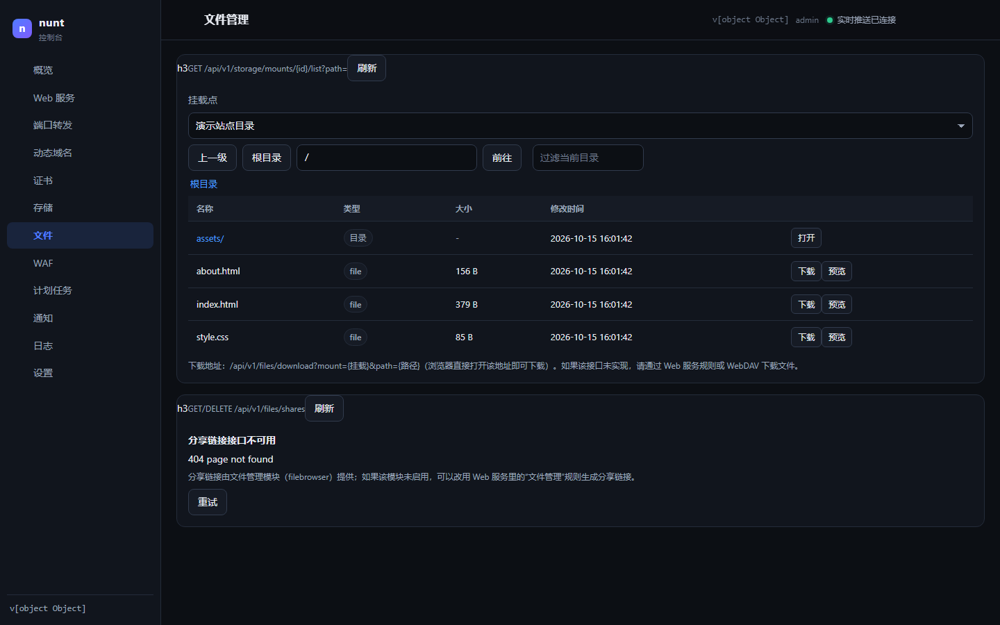

- 截图：[files.png](files.png) ｜ URL `http://127.0.0.1:16601/#/files`
- 挂载：是 ｜ 网络空闲：是 ｜ 采集耗时 1641ms
- 顶栏标题 `文件管理` ｜ 内容子节点 1 ｜ 文档高度 900px ｜ 视口宽 1440
- axe：严重 2 / 重要 4 / 中等 22 / 轻微 1（通过项 31，待人工确认 1）

**console 报错与警告**

```text
[error] Failed to load resource: the server responded with a status of 404 (Not Found)  (http://127.0.0.1:16601/api/v1/files/shares:0)
[error] Failed to load resource: the server responded with a status of 404 (Not Found)  (http://127.0.0.1:16601/api/v1/files/shares:0)
```

**未捕获异常**

```text
（无）
```

**失败请求**

```text
（无）
```

**HTTP 4xx/5xx**

```text
404 GET http://127.0.0.1:16601/api/v1/files/shares
404 GET http://127.0.0.1:16601/api/v1/files/shares
```

**axe 违规明细**

| 规则 | 影响 | 节点数 | 说明 | 示例选择器 |
| --- | --- | --- | --- | --- |
| `button-name` | critical | 1 | Buttons must have discernible text | `button[data-theme-toggle="1"]` |
| `color-contrast` | serious | 4 | Elements must meet minimum color contrast ratio thresholds | `.brand-sub`, `.active > .nav-text`, `.meta:nth-child(4) > .mono[data-version="1"][title="版本信息"]` |
| `empty-table-header` | minor | 1 | Table header text should not be empty | `th:nth-child(5)` |
| `landmark-one-main` | moderate | 1 | Document should have one main landmark | `html` |
| `page-has-heading-one` | moderate | 1 | Page should contain a level-one heading | `html` |
| `region` | moderate | 20 | All page content should be contained by landmarks | `.card:nth-child(2) > .card-head > span:nth-child(1)`, `.card:nth-child(2) > .card-head > .muted`, `.pfiles-tools > .muted` |
| `select-name` | critical | 1 | Select element must have an accessible name | `select` |

### WAF（`#/waf`）

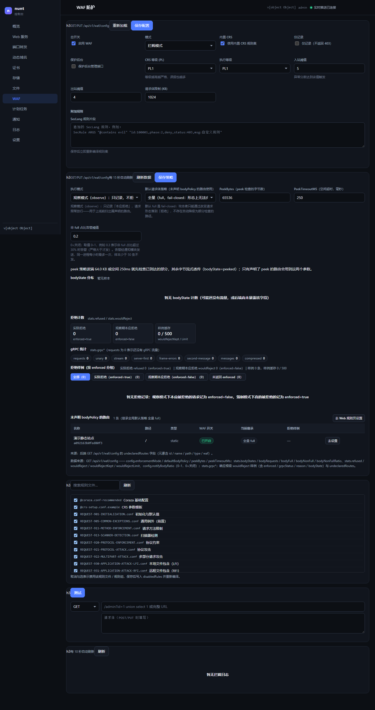

- 截图：[waf.png](waf.png) ｜ URL `http://127.0.0.1:16601/#/waf`
- 挂载：是 ｜ 网络空闲：是 ｜ 采集耗时 1984ms
- 顶栏标题 `WAF 防护` ｜ 内容子节点 1 ｜ 文档高度 2726px ｜ 视口宽 1440
- axe：严重 9 / 重要 14 / 中等 34 / 轻微 1（通过项 32，待人工确认 1）

**console 报错与警告**

```text
（无）
```

**未捕获异常**

```text
（无）
```

**失败请求**

```text
（无）
```

**HTTP 4xx/5xx**

```text
（无）
```

**axe 违规明细**

| 规则 | 影响 | 节点数 | 说明 | 示例选择器 |
| --- | --- | --- | --- | --- |
| `button-name` | critical | 1 | Buttons must have discernible text | `button[data-theme-toggle="1"]` |
| `color-contrast` | serious | 14 | Elements must meet minimum color contrast ratio thresholds | `.brand-sub`, `.active > .nav-text`, `.meta:nth-child(4) > .mono[data-version="1"][title="版本信息"]` |
| `empty-table-header` | minor | 1 | Table header text should not be empty | `th:nth-child(7)` |
| `label` | critical | 2 | Form elements must have labels | `.field:nth-child(8) > .input[type="number"][min="0"]`, `.field:nth-child(9) > .input[type="number"][min="0"]` |
| `landmark-one-main` | moderate | 1 | Document should have one main landmark | `html` |
| `page-has-heading-one` | moderate | 1 | Page should contain a level-one heading | `html` |
| `region` | moderate | 32 | All page content should be contained by landmarks | `.card:nth-child(2) > .card-head > span:nth-child(1)`, `.card:nth-child(2) > .card-head > .muted`, `.card:nth-child(2) > .pwaf-panel.card-body` |
| `select-name` | critical | 6 | Select element must have an accessible name | `.card:nth-child(2) > .pwaf-panel.card-body > div > .grid > .field:nth-child(2) > select`, `.field:nth-child(6) > select`, `.field:nth-child(7) > select` |

### 计划任务（`#/task`）

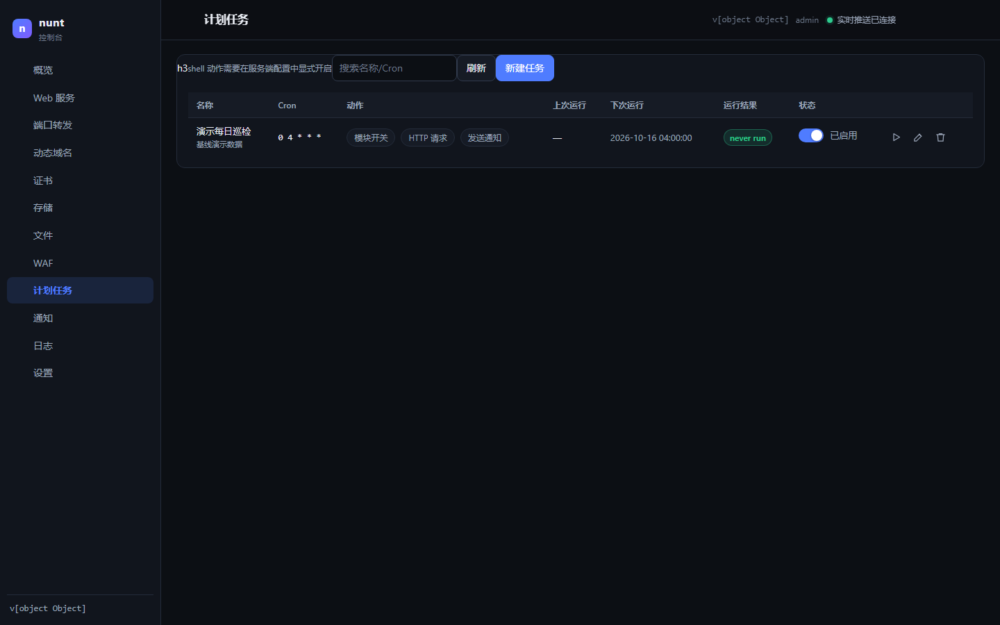

- 截图：[task.png](task.png) ｜ URL `http://127.0.0.1:16601/#/task`
- 挂载：是 ｜ 网络空闲：是 ｜ 采集耗时 1689ms
- 顶栏标题 `计划任务` ｜ 内容子节点 1 ｜ 文档高度 900px ｜ 视口宽 1440
- axe：严重 1 / 重要 5 / 中等 13 / 轻微 1（通过项 31，待人工确认 1）

**console 报错与警告**

```text
（无）
```

**未捕获异常**

```text
（无）
```

**失败请求**

```text
（无）
```

**HTTP 4xx/5xx**

```text
（无）
```

**axe 违规明细**

| 规则 | 影响 | 节点数 | 说明 | 示例选择器 |
| --- | --- | --- | --- | --- |
| `button-name` | critical | 1 | Buttons must have discernible text | `button[data-theme-toggle="1"]` |
| `color-contrast` | serious | 5 | Elements must meet minimum color contrast ratio thresholds | `.brand-sub`, `.active > .nav-text`, `.meta:nth-child(4) > .mono[data-version="1"][title="版本信息"]` |
| `empty-table-header` | minor | 1 | Table header text should not be empty | `th:nth-child(8)` |
| `landmark-one-main` | moderate | 1 | Document should have one main landmark | `html` |
| `page-has-heading-one` | moderate | 1 | Page should contain a level-one heading | `html` |
| `region` | moderate | 11 | All page content should be contained by landmarks | `.card-head > span:nth-child(1)`, `.card-head > .muted`, `.input` |

### 通知（`#/notify`）

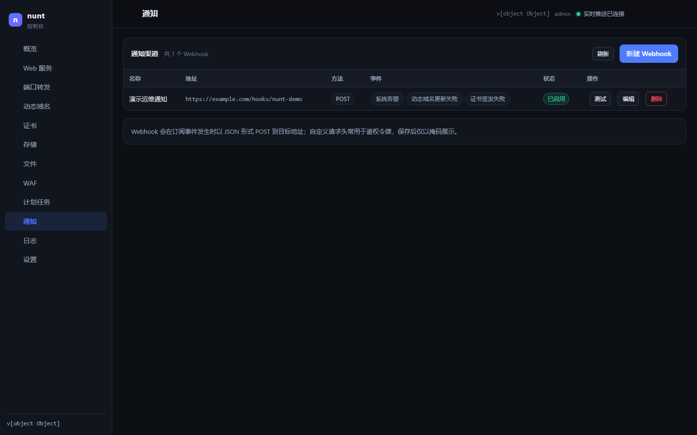

- 截图：[notify.png](notify.png) ｜ URL `http://127.0.0.1:16601/#/notify`
- 挂载：是 ｜ 网络空闲：是 ｜ 采集耗时 1668ms
- 顶栏标题 `通知` ｜ 内容子节点 1 ｜ 文档高度 900px ｜ 视口宽 1440
- axe：严重 1 / 重要 6 / 中等 11 / 轻微 0（通过项 28，待人工确认 1）

**console 报错与警告**

```text
（无）
```

**未捕获异常**

```text
（无）
```

**失败请求**

```text
（无）
```

**HTTP 4xx/5xx**

```text
（无）
```

**axe 违规明细**

| 规则 | 影响 | 节点数 | 说明 | 示例选择器 |
| --- | --- | --- | --- | --- |
| `button-name` | critical | 1 | Buttons must have discernible text | `button[data-theme-toggle="1"]` |
| `color-contrast` | serious | 6 | Elements must meet minimum color contrast ratio thresholds | `.brand-sub`, `.active > .nav-text`, `.meta:nth-child(4) > .mono[data-version="1"][title="版本信息"]` |
| `landmark-one-main` | moderate | 1 | Document should have one main landmark | `html` |
| `page-has-heading-one` | moderate | 1 | Page should contain a level-one heading | `html` |
| `region` | moderate | 9 | All page content should be contained by landmarks | `.card-header > span:nth-child(1)`, `.sub`, `thead` |

### 日志（`#/logs`）

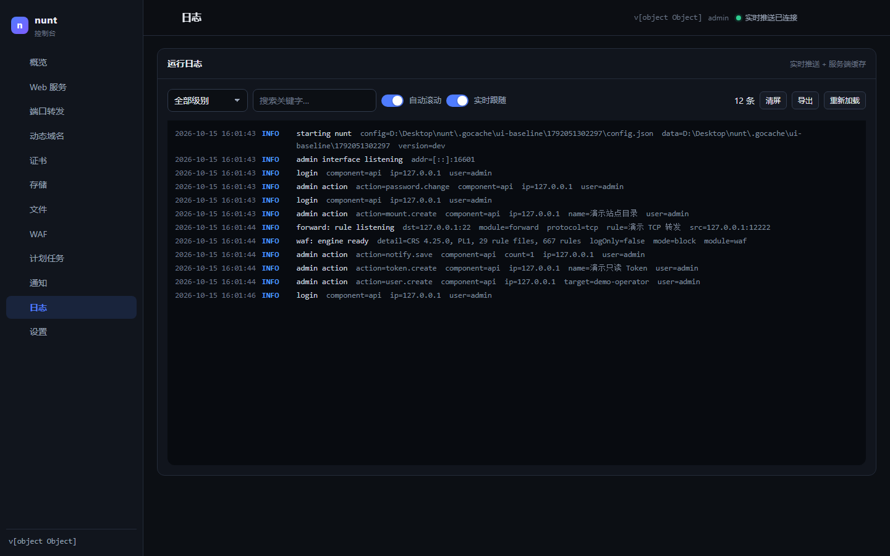

- 截图：[logs.png](logs.png) ｜ URL `http://127.0.0.1:16601/#/logs`
- 挂载：是 ｜ 网络空闲：是 ｜ 采集耗时 1654ms
- 顶栏标题 `日志` ｜ 内容子节点 1 ｜ 文档高度 900px ｜ 视口宽 1440
- axe：严重 1 / 重要 17 / 中等 9 / 轻微 0（通过项 27，待人工确认 1）

**console 报错与警告**

```text
（无）
```

**未捕获异常**

```text
（无）
```

**失败请求**

```text
（无）
```

**HTTP 4xx/5xx**

```text
（无）
```

**axe 违规明细**

| 规则 | 影响 | 节点数 | 说明 | 示例选择器 |
| --- | --- | --- | --- | --- |
| `button-name` | critical | 1 | Buttons must have discernible text | `button[data-theme-toggle="1"]` |
| `color-contrast` | serious | 17 | Elements must meet minimum color contrast ratio thresholds | `.brand-sub`, `.active > .nav-text`, `.meta:nth-child(4) > .mono[data-version="1"][title="版本信息"]` |
| `landmark-one-main` | moderate | 1 | Document should have one main landmark | `html` |
| `page-has-heading-one` | moderate | 1 | Page should contain a level-one heading | `html` |
| `region` | moderate | 7 | All page content should be contained by landmarks | `.card-header`, `select`, `.input` |

### 设置（`#/settings`）

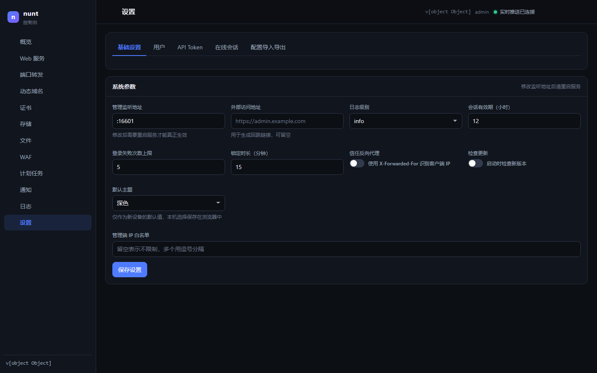

- 截图：[settings.png](settings.png) ｜ URL `http://127.0.0.1:16601/#/settings`
- 挂载：是 ｜ 网络空闲：是 ｜ 采集耗时 1610ms
- 顶栏标题 `设置` ｜ 内容子节点 1 ｜ 文档高度 900px ｜ 视口宽 1440
- axe：严重 6 / 重要 9 / 中等 4 / 轻微 0（通过项 28，待人工确认 1）

**console 报错与警告**

```text
（无）
```

**未捕获异常**

```text
（无）
```

**失败请求**

```text
（无）
```

**HTTP 4xx/5xx**

```text
（无）
```

**axe 违规明细**

| 规则 | 影响 | 节点数 | 说明 | 示例选择器 |
| --- | --- | --- | --- | --- |
| `button-name` | critical | 1 | Buttons must have discernible text | `button[data-theme-toggle="1"]` |
| `color-contrast` | serious | 9 | Elements must meet minimum color contrast ratio thresholds | `.brand-sub`, `button[data-page="settings"] > .nav-text`, `.meta:nth-child(4) > .mono[data-version="1"][title="版本信息"]` |
| `label` | critical | 3 | Form elements must have labels | `input[max="720"]`, `input[max="100"]`, `input[max="1440"]` |
| `landmark-one-main` | moderate | 1 | Document should have one main landmark | `html` |
| `page-has-heading-one` | moderate | 1 | Page should contain a level-one heading | `html` |
| `region` | moderate | 2 | All page content should be contained by landmarks | `.card-header`, `.grid` |
| `select-name` | critical | 2 | Select element must have an accessible name | `.field:nth-child(3) > select`, `.field:nth-child(9) > select` |

## 4. axe 汇总（严重 / 重要）

| 页面 | critical | serious | moderate | minor | 主要规则 |
| --- | --- | --- | --- | --- | --- |
| #/dashboard | 1 | 28 | 22 | 0 | button-name, color-contrast, landmark-one-main, page-has-heading-one |
| #/web | 1 | 5 | 23 | 1 | button-name, color-contrast, empty-table-header, landmark-one-main |
| #/forward | 1 | 5 | 12 | 1 | button-name, color-contrast, empty-table-header, landmark-one-main |
| #/ddns | 1 | 5 | 14 | 1 | button-name, color-contrast, empty-table-header, landmark-one-main |
| #/acme | 1 | 6 | 14 | 1 | button-name, color-contrast, empty-table-header, landmark-one-main |
| #/storage | 1 | 6 | 10 | 0 | button-name, color-contrast, landmark-one-main, page-has-heading-one |
| #/files | 2 | 4 | 22 | 1 | button-name, color-contrast, empty-table-header, landmark-one-main |
| #/waf | 9 | 14 | 34 | 1 | button-name, color-contrast, empty-table-header, label |
| #/task | 1 | 5 | 13 | 1 | button-name, color-contrast, empty-table-header, landmark-one-main |
| #/notify | 1 | 6 | 11 | 0 | button-name, color-contrast, landmark-one-main, page-has-heading-one |
| #/logs | 1 | 17 | 9 | 0 | button-name, color-contrast, landmark-one-main, page-has-heading-one |
| #/settings | 6 | 9 | 4 | 0 | button-name, color-contrast, label, landmark-one-main |
| **合计** | **26** | **110** | **188** | **7** | |

跨页面重复出现的规则（按节点数排序）：

| 规则 | 影响 | 总节点数 | 出现页面 | 说明 |
| --- | --- | --- | --- | --- |
| `region` | moderate | 164 | dashboard, web, forward, ddns, acme, storage, files, waf, task, notify, logs, settings | All page content should be contained by landmarks |
| `color-contrast` | serious | 110 | dashboard, web, forward, ddns, acme, storage, files, waf, task, notify, logs, settings | Elements must meet minimum color contrast ratio thresholds |
| `button-name` | critical | 12 | dashboard, web, forward, ddns, acme, storage, files, waf, task, notify, logs, settings | Buttons must have discernible text |
| `landmark-one-main` | moderate | 12 | dashboard, web, forward, ddns, acme, storage, files, waf, task, notify, logs, settings | Document should have one main landmark |
| `page-has-heading-one` | moderate | 12 | dashboard, web, forward, ddns, acme, storage, files, waf, task, notify, logs, settings | Page should contain a level-one heading |
| `select-name` | critical | 9 | files, waf, settings | Select element must have an accessible name |
| `empty-table-header` | minor | 7 | web, forward, ddns, acme, files, waf, task | Table header text should not be empty |
| `label` | critical | 5 | waf, settings | Form elements must have labels |

## 5. 关于「网络空闲」与 SSE

`/api/v1/events` 是一条 SSE 长连接，文档加载完成后仍有一条挂起请求，因此
`waitForLoadState('networkidle')` 基本不会满足（脚本按 6 秒超时处理，结果记在上面的「网络空闲」列）。
这不是业务缺陷，但会干扰任何基于 networkidle 的自动化测试：迁移后应改为等待明确的就绪信号。

切换页面时被主动中断的 SSE 请求（未计入失败请求）：0 条。

## 6. 视觉问题清单（人工复核）

这一节是人工逐张看 12 张截图（1440×900，深色主题）得出的清单，配合第 1~4 节的机器数据看。
所有截图都在本目录：`login.png` 与 12 个 `<page>.png`。

### A. 渲染错误（先修这些，它们是用户「样式有问题」抱怨里最刺眼的部分）

1. **7 个页面的卡片标题被渲染成字面量 "h3"，标题文字整个丢失。**
   受影响页面：`web`、`forward`、`ddns`、`acme`、`files`、`waf`、`task`（共 12 页里的 7 页）。
   证据：
   - [web.png](web.png) 第一张卡片顶部是 `h3点击规则行可查看最近访问日志`；
   - [files.png](files.png) 是 `h3GET /api/v1/storage/mounts/{id}/list?path=` 与 `h3GET/DELETE /api/v1/files/shares`；
   - [waf.png](waf.png) 有 5 处（`h3 GET/PUT /api/v1/waf/config`、`h3 测试`、`h3 每 10 秒自动刷新` 等）；
   - [forward.png](forward.png) 甚至只剩一个孤零零的 `h3` 占了一行；
   - 反例：[dashboard.png](dashboard.png) 的「系统指标/模块状态/最近日志」、[settings.png](settings.png) 的「系统参数」、[storage.png](storage.png) 的「存储挂载」、[notify.png](notify.png) 的「通知渠道」、[logs.png](logs.png) 的「运行日志」都正常。
   根因（已定位）：这 7 个页面各自内置了一份本地兜底的 `el()`（见 `internal/webui/assets/pages/waf.js:59` 等），
   判断标签名用的是 `/^[a-zA-Z]+$/` —— 这个正则不接受数字，而 `h3` 带数字，
   于是走了「回退分支」：`makeEl('span', null, ['h3'], false)`，属性对象被丢弃，结果是 `<span>h3</span>`。
   另外 5 个页面（dashboard/storage/notify/logs/settings）已经改成直接用 `lib/ui.js` 的 `el()`，
   所以同一个控制台里同时存在「对的」和「错的」两套渲染路径 —— 这正是「半新半旧」的观感来源。
   现场验证：`.gocache/dom-probe.mjs` 打出的真实 DOM 是 `<div class="card-head"><span>h3</span>...`，
   而在同一页面里 `el('h3', { text: 'WAF 配置' })`（lib 版）得到的是正确的 `<h3>WAF 配置</h3>`。

2. **版本号显示成 `[object Object]`。** 三处：顶栏右上（`v[object Object]`）、左侧栏底部（`v[object Object]`）、
   [dashboard.png](dashboard.png) 的「版本」卡片（`[object Object]`）。
   `GET /api/v1/system/info` 的 `version` 字段是对象，前端直接拼进文本节点。

3. **/files 页面把后端的原始 404 文案直接摊在界面上。** [files.png](files.png) 第二张卡片显示
   「分享链接接口不可用 / `404 page not found`」（Go 的默认响应体）。该请求 `GET /api/v1/files/shares` 在未启用 filebrowser 模块时确实 404，
   但界面应该只给一句人话，而不是把协议层的原文透出来（同一页还重复请求了两次，见第 3 节 console）。

### B. 布局与视觉一致性

4. **表格列宽失衡，内容被挤到变形。** [web.png](web.png) 最明显：名称列窄到「演示静态站点」断成两行；
   状态列把「已启用」竖排成三行（已/启/用）；操作列的三个图标按钮竖着排且最右边一个被表格边缘裁切；
   目标列的超长路径（`D:\Desktop\nunt\.gocache\ui-baseline\...\www`）换行后把行高撑到别的行的两倍。
   表头「操作」是空列（axe 的 `empty-table-header` 在 7 个页面都报了）。

5. **标题与提示文字粘在一起。** 卡片头里 `h3` 丢失后，提示文字顶到了最左边（「h3点击规则行…」），
   标题与说明之间没有任何视觉分隔；[forward.png](forward.png) 只剩一个 `h3` 占位，看着像没写完的页面。

6. **同一种「操作」在不同页面是两种控件。** 规则类页面（web/forward/ddns/acme/task）用图标按钮，
   [storage.png](storage.png)、[notify.png](notify.png) 用文字按钮（浏览/测试/编辑/删除）。行高、对齐、可点击区都不一样。

7. **中英文混排。** 概览页模块卡片标题是 `Certificates`/`Port forwarding`/`Scheduled tasks`/`Web service`
   （旁边「动态域名」「Web 应用防火墙」却是中文）；[task.png](task.png) 运行结果标签是 `never run`；
   [files.png](files.png) 类型列 `file`/`目录` 混用；按钮「新建 Webhook」。

8. **空状态与空白区域过大。** [acme.png](acme.png) 的「暂无已签发的证书」占了半屏高；
   [logs.png](logs.png) 日志框下方留了整屏空白；[waf.png](waf.png) 的「暂无 bodyState 计数」区域是几个大灰块。
   页面高度差也很夸张：概览 1389px、WAF 2726px，其余 10 页都正好 900px（内容不足一屏）。

9. **概览页卡片网格两行不同列宽。** [dashboard.png](dashboard.png) 第一行 4 张卡（CPU/Go 内存/主机内存/磁盘）、
   第二行 3 张卡（系统负载/运行时长/版本），两行的列边界对不齐；「主机内存」「磁盘」「系统负载」在 Windows 上永远是「—」+「当前平台未提供」，
   等于 4 张卡里 3 张是空的。

10. **日志换行没有悬挂缩进。** [logs.png](logs.png) 第一条日志折行后从时间戳列的最左边继续，和消息列对不齐，长日志很难扫读。

11. **WAF 页面信息层级混乱。** [waf.png](waf.png) 把接口路径当正文展示（`GET/PUT /api/v1/waf/config`、`来自 GET /api/v1/waf/config 的 undeclaredRoutes 字段` 之类），
    一屏里塞了配置表单、策略说明、计数面板、规则文件树、测试区、日志区，2726px 里三种字号混排，普通用户很难找到「我要改什么」。
    此外「签发」这种主按钮出现在表格行内（[acme.png](acme.png)），和同行的开关抢视觉重心。

### C. 无障碍（axe 明细见第 4 节，这里是对应的视觉解释）

12. **主题切换按钮没有可访问名称**：12 个页面每个都报一条 `button-name`（critical，`button[data-theme-toggle="1"]`）——
    它是纯图标按钮，只有 `title`，屏幕阅读器读到的是空按钮。
13. **对比度不足共 110 处**：侧栏「控制台」副标题、未选中导航项、顶栏版本号、表格里的次要文字（时间、备注、说明）在深色主题下都是灰压灰；
    日志页一页就有 17 处，概览页 28 处。axe 报的是 `color-contrast`（serious）。
14. **下拉框/输入框没有可访问名称**：waf 页 6 个 `select`、2 个数字输入框，设置页 3 个输入框 + 2 个下拉，文件页 1 个下拉，
    axe 报 `select-name` / `label`（critical）。视觉上它们只是「标签在左边」，但标签没有和控件关联（没有 `for`/`id`）。
15. **没有 `<h1>`、没有 `main` landmark，内容不在 landmark 里**：12 个页面都报
    `landmark-one-main`/`page-has-heading-one`（moderate），`region` 一共 188 处（waf 页 32 处）。
    —— 这条与第 1 条其实是同一个病根：标题元素根本没生成出来，页面自然没有标题层级。

## 7. 静态资源预压缩（阶段 1 追加项，改造后实测）

**改造前（现状）**

- `internal/webui` 用 `http.FileServer` 把嵌入资源原样吐出去，没有任何 `Content-Encoding`；
- 响应里既没有 `ETag` 也没有 `Last-Modified`：`embed.FS` 的 ModTime 是零值（实测 `0001-01-01 00:00:00`，`IsZero=true`），
  而 net/http 只在 modtime 非零时才写 `Last-Modified`，`ETag` 本来也不会自动生成。
  也就是说改造前 `If-None-Match` / `If-Modified-Since` 完全不生效，浏览器只能靠 `Cache-Control: public, max-age=600` 硬扛。

**改造后**（`internal/webui/compress.go` + `asset.go` + `encoder_brotli.go`）

- 首次请求压缩一次并放进内存缓存，键是「资源名 + 编码」；同一编码后续请求直接命中（单测用计数器断言不会重复压缩）；
- 协商顺序 `br > gzip`（同 q 值下 br 优先），`q=0` 视为拒绝，`*` 视为任意；
  只压文本类（`text/*`、JSON、JS、SVG），`png/woff2/gz` 这类已压缩格式跳过；
- 每个编码有独立的 ETag（内容哈希 + 编码后缀），`If-None-Match` 与 `If-Modified-Since` 都能拿到 304；
- Content-Type 改成显式白名单，不再依赖 Windows 注册表驱动的 `mime.TypeByExtension`。

**实测（`curl -w %{size_download}`，服务端真实协商）**

| 资源 | 原始 | gzip | br | br 相对原始 |
| --- | --- | --- | --- | --- |
| index.html | 988 | 572 | 478 | -51.6% |
| app.js | 29447 | 8094 | 7374 | -75.0% |
| style.css | 24099 | 5665 | 5468 | -77.3% |
| pages/waf.js | 102104 | 29953 | 27184 | -73.4% |

整棵前端资源树（303 个文件，含本轮新 vendor 的 Shoelace）：

- 原始 1,203,945 字节；
- 全部按 gzip 传输 357,727 字节（-70.3%）；
- 全部按 br 传输 328,996 字节（-72.7%）；
- 其中 302 个文本资源本体：1,199,475 → gzip 353,257 / br 324,526。

br 质量取 6：q11 还能再小 8%~12%，但压缩耗时是 q6 的 20~30 倍（waf.js 216ms vs 7.8ms），
放在「首个请求才压缩」的路径上不划算。

> 这一节是人工补写的：脚本重新生成 REPORT.md 时会保留第 6 节（读 `VISUAL-REVIEW.md`），但不会保留本节。

---

原始数据见同目录 `baseline.json`（含每页 console/请求/axe 明细），无障碍统计见 `a11y.json`。
