# 前端基线报告（phase2 batch D）

> 由 `scripts/ui-baseline.mjs` 生成，配合 `docs/PLAN-frontend-webcomponents.md` 阶段 0 使用。
> 重新运行脚本会覆盖本文件的机器部分，但会保留 `VISUAL-REVIEW.md` 中的人工视觉复核内容。

- 生成时间：2026-10-16T05:19:36.782Z
- 二进制：`D:\Desktop\nunt\nunt.exe`（31831552 字节）
- 数据目录：`D:\Desktop\nunt\.gocache\ui-baseline\1792127943036`（运行结束后已删除）
- 浏览器：Mozilla/5.0 (Windows NT 10.0; Win64; x64) AppleWebKit/537.36 (KHTML, like Gecko) HeadlessChrome/156.0.8078.4 Safari/537.36
- 视口：1440x900，color-scheme dark，语言 zh-CN
- axe-core：4.14.0（本地注入，运行时版本 4.14.0；规则标签 wcag2a, wcag2aa, wcag21a, wcag21aa, best-practice）
- 运行环境：v24.15.0 / playwright 1.64.1

## 1. 结论速览

| 指标 | 数值 |
| --- | --- |
| 页面数 | 12 |
| 页面未挂载出内容 | 0 |
| 达到网络空闲的页面 | 12/12 |
| console 报错+警告 | 0 |
| 未捕获异常（pageerror） | 0 |
| 失败请求 | 0 |
| HTTP 4xx/5xx 响应 | 0 |
| 外部请求（离开本服务） | 0 |
| axe 严重 critical | 0 |
| axe 重要 serious | 0 |
| axe 中等 moderate | 0 |
| axe 轻微 minor | 0 |
| 横向溢出的页面 | 0 |
| 文档高度平均值 | 1152px |

演示数据播种：11/11 成功。

## 2. 演示数据（由管理 API 播种）

| 步骤 | 请求 | 状态 | 结果 |
| --- | --- | --- | --- |
| 存储挂载（本地目录） | `POST /api/v1/storage/mounts` | 200 | OK（id=44e963a300eb4162） |
| Web 规则：静态托管 | `POST /api/v1/web/rules` | 200 | OK（id=9e658f6eb29156c8） |
| Web 规则：反向代理 | `POST /api/v1/web/rules` | 200 | OK（id=e39231bde41147b7） |
| 端口转发规则 | `POST /api/v1/forward/rules` | 201 | OK（id=1dcde1bb5eaad582） |
| DDNS 规则 | `POST /api/v1/ddns/rules` | 200 | OK（id=3f6c18b7579ba742） |
| WAF 配置 | `PUT /api/v1/waf/config` | 200 | OK |
| 通知 Webhook | `PUT /api/v1/notify/webhooks` | 200 | OK |
| 计划任务 | `POST /api/v1/task/items` | 201 | OK（id=6c77fa8b61469acf） |
| 证书任务（未启用） | `POST /api/v1/acme/jobs` | 200 | OK（id=3574b77916768eaa） |
| API Token | `POST /api/v1/auth/tokens` | 200 | OK（id=8e774c5ca6a93545） |
| 第二个管理员账号 | `POST /api/v1/auth/users` | 200 | OK（id=d766d33103fb1b52） |

## 3. 逐页结果

### 登录页（附加）

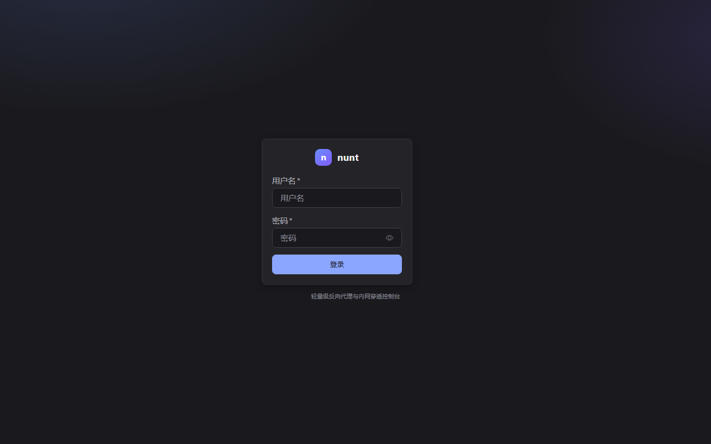

- 截图：[login.png](login.png)
- console 报错与警告：（无）
- 失败请求：（无）
- 外部请求：（无）
- axe：严重 0 / 重要 0 / 中等 0 / 轻微 0（通过项 34）

### 概览（`#/dashboard`）

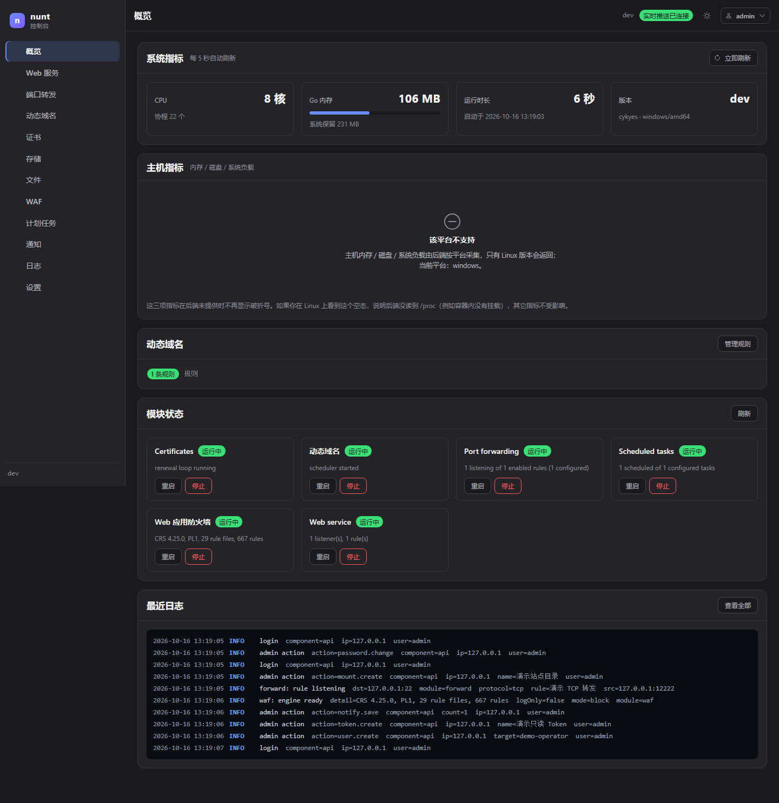

- 截图：[dashboard.png](dashboard.png) ｜ URL `http://127.0.0.1:16601/#/dashboard`
- 挂载：是 ｜ 网络空闲：是 ｜ 采集耗时 2153ms
- 顶栏标题 `概览` ｜ 内容子节点 1 ｜ 文档高度 1486px ｜ 视口宽 1440
- axe：严重 0 / 重要 0 / 中等 0 / 轻微 0（通过项 34，待人工确认 1）

**console 报错与警告**

```text
（无）
```

**未捕获异常**

```text
（无）
```

**失败请求**

```text
（无）
```

**HTTP 4xx/5xx**

```text
（无）
```

**外部请求**

```text
（无）
```

**axe 违规明细**

（无）

### Web 服务（`#/web`）

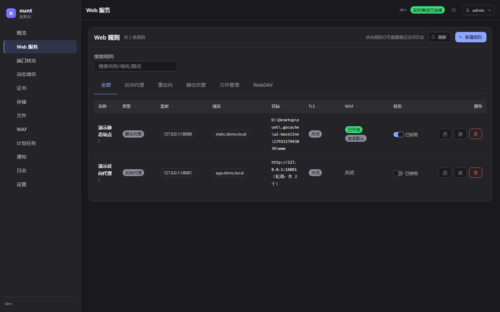

- 截图：[web.png](web.png) ｜ URL `http://127.0.0.1:16601/#/web`
- 挂载：是 ｜ 网络空闲：是 ｜ 采集耗时 2162ms
- 顶栏标题 `Web 服务` ｜ 内容子节点 1 ｜ 文档高度 900px ｜ 视口宽 1440
- axe：严重 0 / 重要 0 / 中等 0 / 轻微 0（通过项 47，待人工确认 1）

**console 报错与警告**

```text
（无）
```

**未捕获异常**

```text
（无）
```

**失败请求**

```text
（无）
```

**HTTP 4xx/5xx**

```text
（无）
```

**外部请求**

```text
（无）
```

**axe 违规明细**

（无）

### 端口转发（`#/forward`）

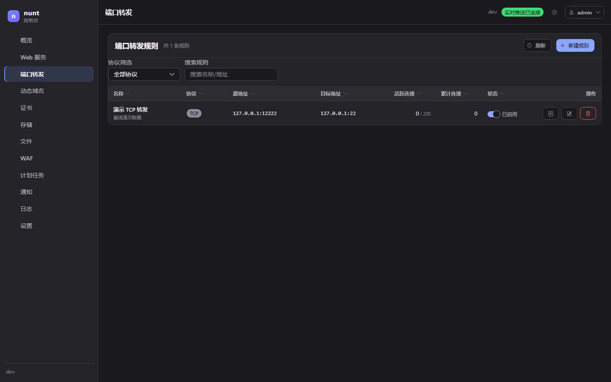

- 截图：[forward.png](forward.png) ｜ URL `http://127.0.0.1:16601/#/forward`
- 挂载：是 ｜ 网络空闲：是 ｜ 采集耗时 2063ms
- 顶栏标题 `端口转发` ｜ 内容子节点 1 ｜ 文档高度 900px ｜ 视口宽 1440
- axe：严重 0 / 重要 0 / 中等 0 / 轻微 0（通过项 44，待人工确认 2）

**console 报错与警告**

```text
（无）
```

**未捕获异常**

```text
（无）
```

**失败请求**

```text
（无）
```

**HTTP 4xx/5xx**

```text
（无）
```

**外部请求**

```text
（无）
```

**axe 违规明细**

（无）

### 动态域名（`#/ddns`）

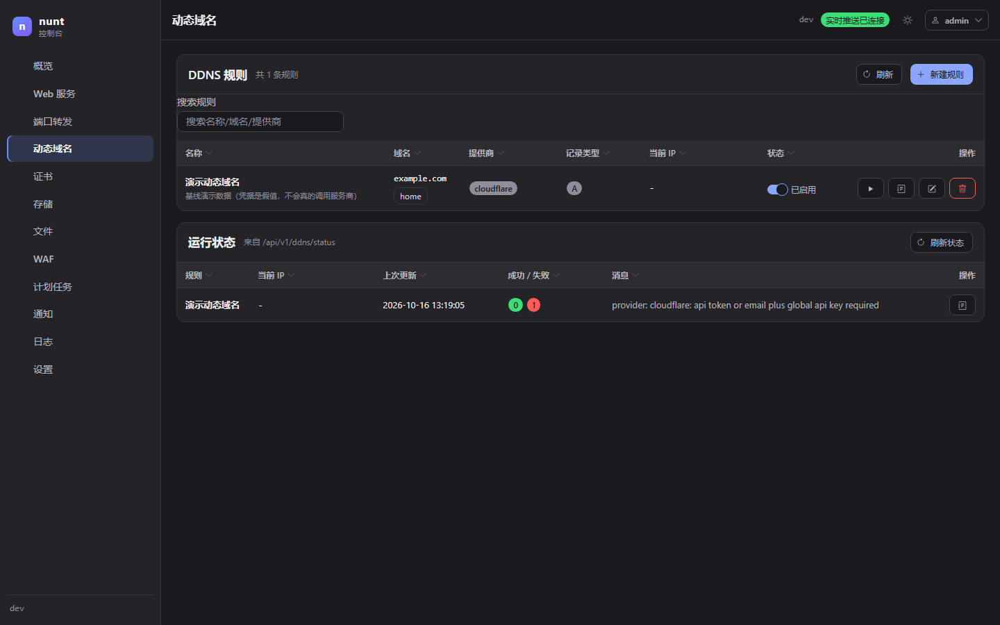

- 截图：[ddns.png](ddns.png) ｜ URL `http://127.0.0.1:16601/#/ddns`
- 挂载：是 ｜ 网络空闲：是 ｜ 采集耗时 2049ms
- 顶栏标题 `动态域名` ｜ 内容子节点 1 ｜ 文档高度 900px ｜ 视口宽 1440
- axe：严重 0 / 重要 0 / 中等 0 / 轻微 0（通过项 44，待人工确认 1）

**console 报错与警告**

```text
（无）
```

**未捕获异常**

```text
（无）
```

**失败请求**

```text
（无）
```

**HTTP 4xx/5xx**

```text
（无）
```

**外部请求**

```text
（无）
```

**axe 违规明细**

（无）

### 证书（`#/acme`）

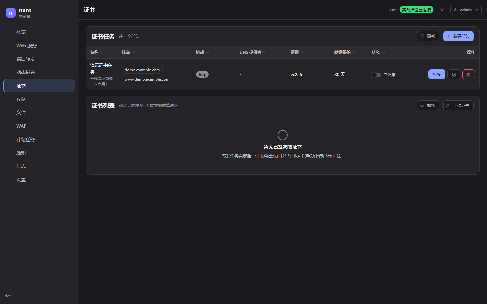

- 截图：[acme.png](acme.png) ｜ URL `http://127.0.0.1:16601/#/acme`
- 挂载：是 ｜ 网络空闲：是 ｜ 采集耗时 2206ms
- 顶栏标题 `证书` ｜ 内容子节点 1 ｜ 文档高度 900px ｜ 视口宽 1440
- axe：严重 0 / 重要 0 / 中等 0 / 轻微 0（通过项 44，待人工确认 1）

**console 报错与警告**

```text
（无）
```

**未捕获异常**

```text
（无）
```

**失败请求**

```text
（无）
```

**HTTP 4xx/5xx**

```text
（无）
```

**外部请求**

```text
（无）
```

**axe 违规明细**

（无）

### 存储（`#/storage`）

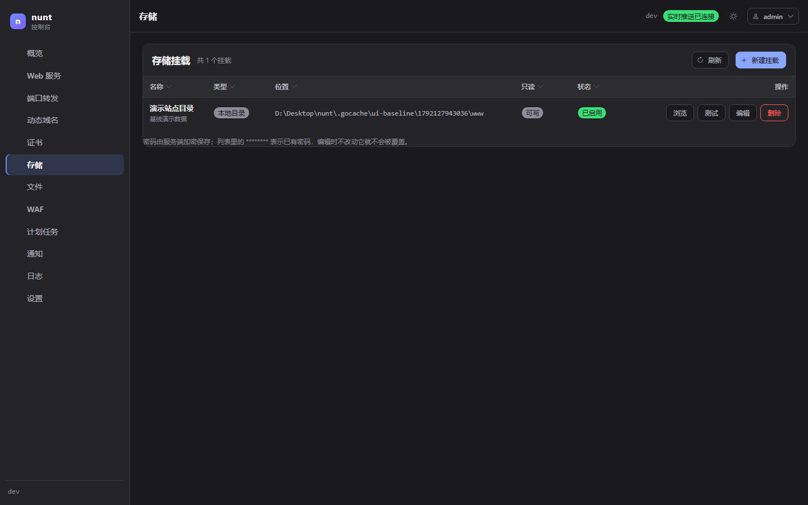

- 截图：[storage.png](storage.png) ｜ URL `http://127.0.0.1:16601/#/storage`
- 挂载：是 ｜ 网络空闲：是 ｜ 采集耗时 1995ms
- 顶栏标题 `存储` ｜ 内容子节点 1 ｜ 文档高度 900px ｜ 视口宽 1440
- axe：严重 0 / 重要 0 / 中等 0 / 轻微 0（通过项 40，待人工确认 1）

**console 报错与警告**

```text
（无）
```

**未捕获异常**

```text
（无）
```

**失败请求**

```text
（无）
```

**HTTP 4xx/5xx**

```text
（无）
```

**外部请求**

```text
（无）
```

**axe 违规明细**

（无）

### 文件（`#/files`）

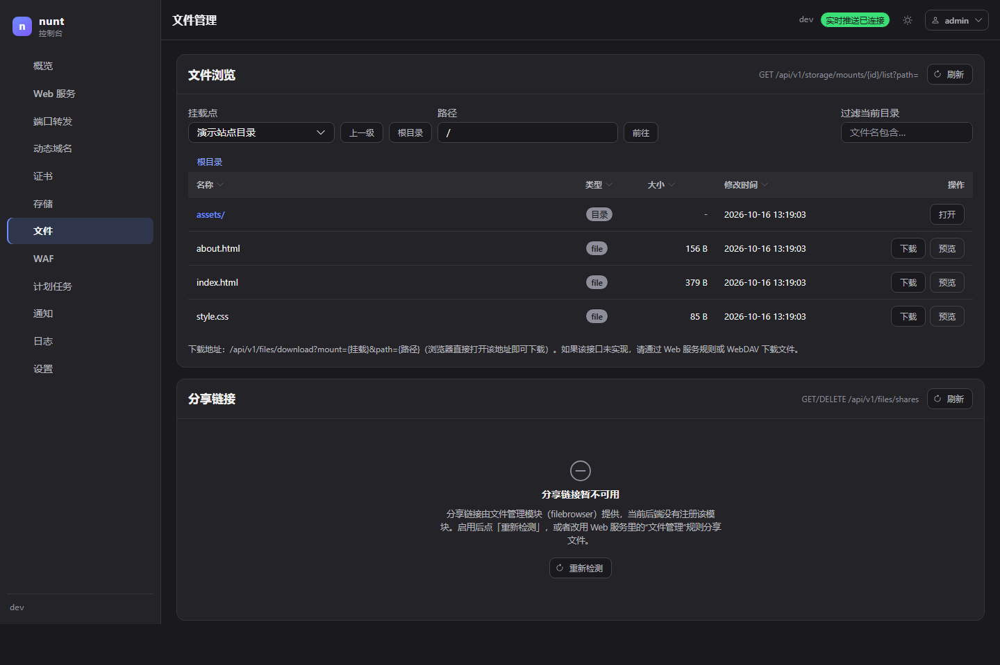

- 截图：[files.png](files.png) ｜ URL `http://127.0.0.1:16601/#/files`
- 挂载：是 ｜ 网络空闲：是 ｜ 采集耗时 2071ms
- 顶栏标题 `文件管理` ｜ 内容子节点 1 ｜ 文档高度 959px ｜ 视口宽 1440
- axe：严重 0 / 重要 0 / 中等 0 / 轻微 0（通过项 43，待人工确认 2）

**console 报错与警告**

```text
（无）
```

**未捕获异常**

```text
（无）
```

**失败请求**

```text
（无）
```

**HTTP 4xx/5xx**

```text
（无）
```

**外部请求**

```text
（无）
```

**axe 违规明细**

（无）

### WAF（`#/waf`）

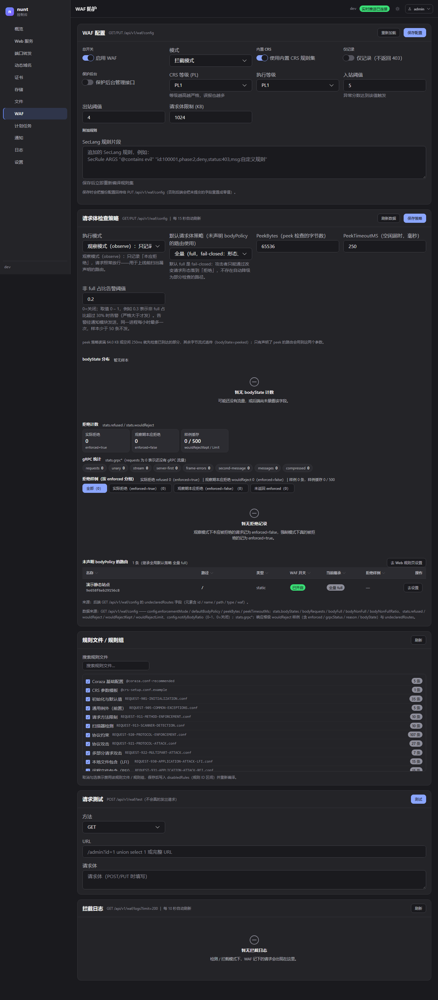

- 截图：[waf.png](waf.png) ｜ URL `http://127.0.0.1:16601/#/waf`
- 挂载：是 ｜ 网络空闲：是 ｜ 采集耗时 3743ms
- 顶栏标题 `WAF 防护` ｜ 内容子节点 1 ｜ 文档高度 3281px ｜ 视口宽 1440
- axe：严重 0 / 重要 0 / 中等 0 / 轻微 0（通过项 45，待人工确认 2）

**console 报错与警告**

```text
（无）
```

**未捕获异常**

```text
（无）
```

**失败请求**

```text
（无）
```

**HTTP 4xx/5xx**

```text
（无）
```

**外部请求**

```text
（无）
```

**axe 违规明细**

（无）

### 计划任务（`#/task`）

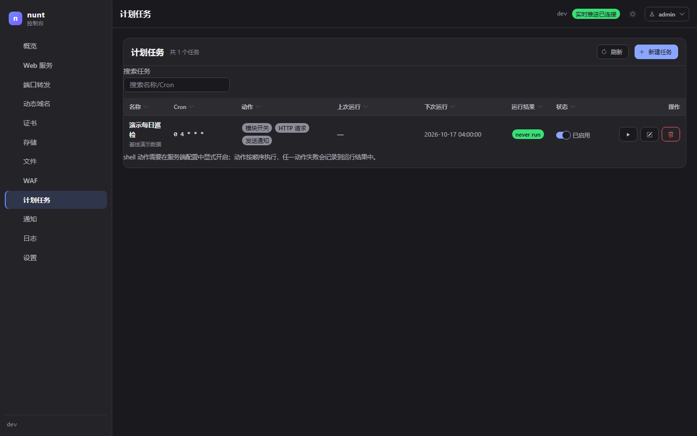

- 截图：[task.png](task.png) ｜ URL `http://127.0.0.1:16601/#/task`
- 挂载：是 ｜ 网络空闲：是 ｜ 采集耗时 1955ms
- 顶栏标题 `计划任务` ｜ 内容子节点 1 ｜ 文档高度 900px ｜ 视口宽 1440
- axe：严重 0 / 重要 0 / 中等 0 / 轻微 0（通过项 44，待人工确认 1）

**console 报错与警告**

```text
（无）
```

**未捕获异常**

```text
（无）
```

**失败请求**

```text
（无）
```

**HTTP 4xx/5xx**

```text
（无）
```

**外部请求**

```text
（无）
```

**axe 违规明细**

（无）

### 通知（`#/notify`）

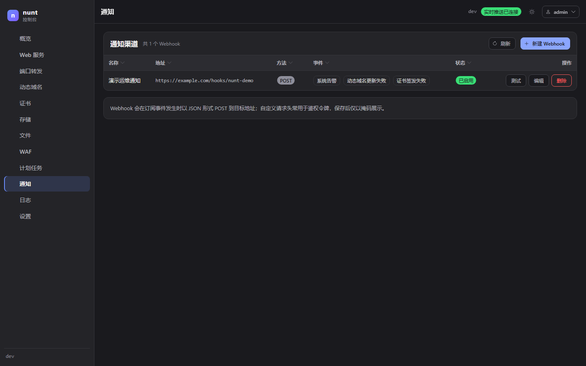

- 截图：[notify.png](notify.png) ｜ URL `http://127.0.0.1:16601/#/notify`
- 挂载：是 ｜ 网络空闲：是 ｜ 采集耗时 2080ms
- 顶栏标题 `通知` ｜ 内容子节点 1 ｜ 文档高度 900px ｜ 视口宽 1440
- axe：严重 0 / 重要 0 / 中等 0 / 轻微 0（通过项 40，待人工确认 1）

**console 报错与警告**

```text
（无）
```

**未捕获异常**

```text
（无）
```

**失败请求**

```text
（无）
```

**HTTP 4xx/5xx**

```text
（无）
```

**外部请求**

```text
（无）
```

**axe 违规明细**

（无）

### 日志（`#/logs`）

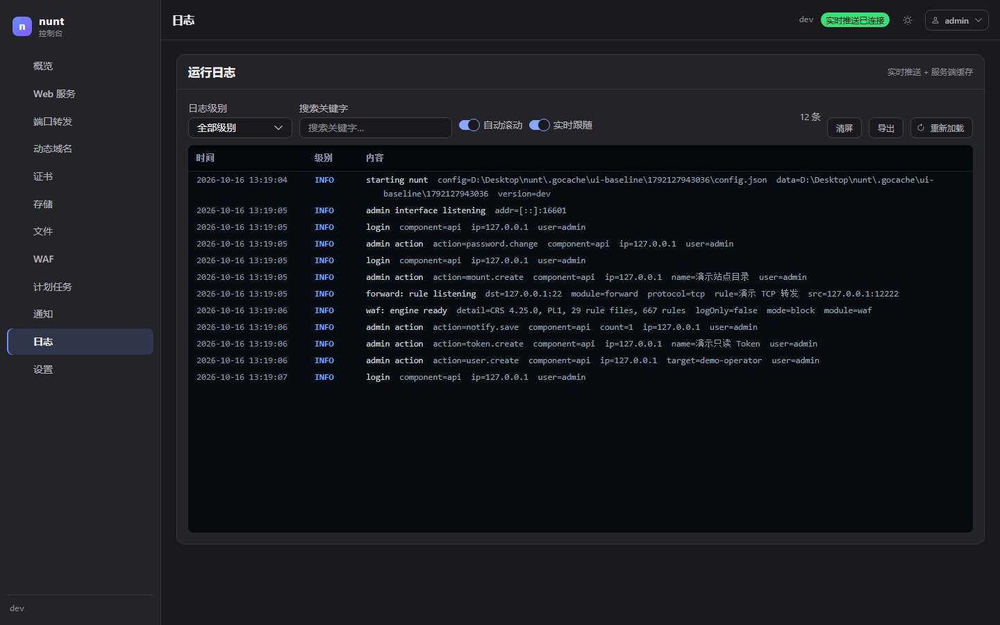

- 截图：[logs.png](logs.png) ｜ URL `http://127.0.0.1:16601/#/logs`
- 挂载：是 ｜ 网络空闲：是 ｜ 采集耗时 2055ms
- 顶栏标题 `日志` ｜ 内容子节点 1 ｜ 文档高度 900px ｜ 视口宽 1440
- axe：严重 0 / 重要 0 / 中等 0 / 轻微 0（通过项 42，待人工确认 2）

**console 报错与警告**

```text
（无）
```

**未捕获异常**

```text
（无）
```

**失败请求**

```text
（无）
```

**HTTP 4xx/5xx**

```text
（无）
```

**外部请求**

```text
（无）
```

**axe 违规明细**

（无）

### 设置（`#/settings`）

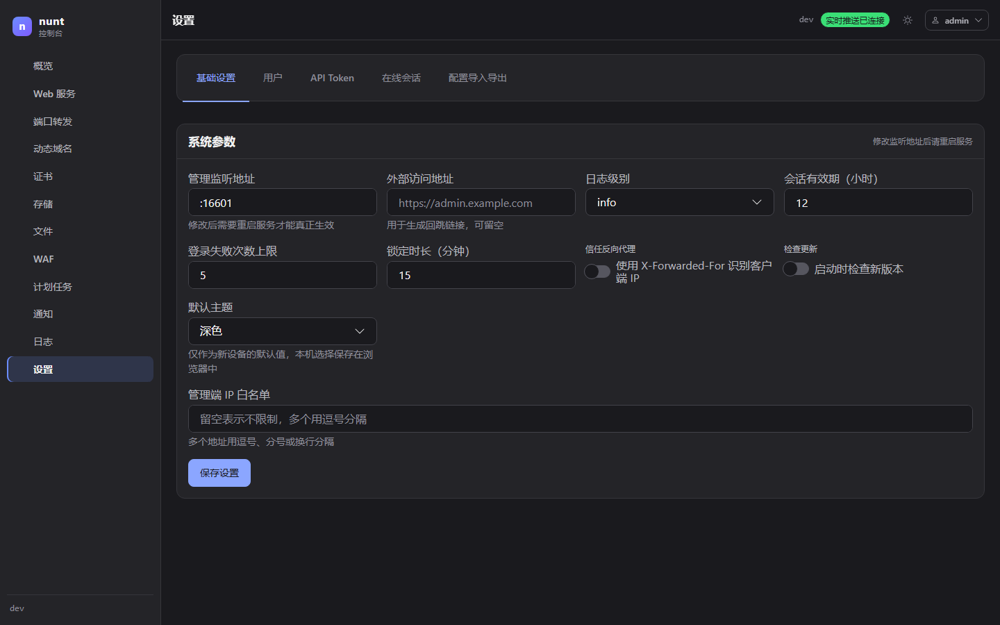

- 截图：[settings.png](settings.png) ｜ URL `http://127.0.0.1:16601/#/settings`
- 挂载：是 ｜ 网络空闲：是 ｜ 采集耗时 1983ms
- 顶栏标题 `设置` ｜ 内容子节点 1 ｜ 文档高度 900px ｜ 视口宽 1440
- axe：严重 0 / 重要 0 / 中等 0 / 轻微 0（通过项 41，待人工确认 2）

**console 报错与警告**

```text
（无）
```

**未捕获异常**

```text
（无）
```

**失败请求**

```text
（无）
```

**HTTP 4xx/5xx**

```text
（无）
```

**外部请求**

```text
（无）
```

**axe 违规明细**

（无）

## 4. axe 汇总（严重 / 重要）

| 页面 | critical | serious | moderate | minor | 主要规则 |
| --- | --- | --- | --- | --- | --- |
| #/dashboard | 0 | 0 | 0 | 0 | — |
| #/web | 0 | 0 | 0 | 0 | — |
| #/forward | 0 | 0 | 0 | 0 | — |
| #/ddns | 0 | 0 | 0 | 0 | — |
| #/acme | 0 | 0 | 0 | 0 | — |
| #/storage | 0 | 0 | 0 | 0 | — |
| #/files | 0 | 0 | 0 | 0 | — |
| #/waf | 0 | 0 | 0 | 0 | — |
| #/task | 0 | 0 | 0 | 0 | — |
| #/notify | 0 | 0 | 0 | 0 | — |
| #/logs | 0 | 0 | 0 | 0 | — |
| #/settings | 0 | 0 | 0 | 0 | — |
| **合计** | **0** | **0** | **0** | **0** | |

跨页面重复出现的规则（按节点数排序）：

（无）

## 5. 关于「网络空闲」与 SSE

`/api/v1/events` 是一条 SSE 长连接，文档加载完成后仍有一条挂起请求，因此
`waitForLoadState('networkidle')` 基本不会满足（脚本按 6 秒超时处理，结果记在上面的「网络空闲」列）。
这不是业务缺陷，但会干扰任何基于 networkidle 的自动化测试：迁移后应改为等待明确的就绪信号。

切换页面时被主动中断的 SSE 请求（未计入失败请求）：0 条。

---

原始数据见同目录 `baseline.json`（含每页 console/请求/axe 明细），无障碍统计见 `a11y.json`。
